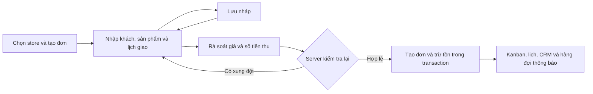

# Fleur — Kế hoạch tạo đơn hàng thủ công trong workspace store

Ngày: 18/10/2026. Đây là plan gốc. Bản đầu đã được triển khai; đối chiếu phạm vi, hướng dẫn và giới hạn tại [MANUAL-ORDERS.md](MANUAL-ORDERS.md). Các phần giai đoạn mở rộng bên dưới vẫn là đề xuất.

## 1. Mục tiêu và phạm vi

Nhân viên tạo đơn từ cuộc gọi, Zalo, Facebook hoặc khách đến cửa hàng; đơn sau khi chốt đi vào cùng luồng vận hành với đơn website: danh sách, Kanban, lịch, thu tiền, CRM, email và báo cáo. Phải biết cửa hàng nào nhận đơn, ai tạo, nguồn khách và số tiền thực thu.

Đề xuất bản đầu gồm: đơn giao tận nơi, khách chỉ có số điện thoại, sản phẩm trong catalog và thiết kế riêng, đơn nháp, tiền cọc, phân công, tag, thông báo. Nhận tại cửa hàng là giai đoạn tiếp theo vì cần thay đổi quy trình hoàn tất, lịch và thông báo; không dùng địa chỉ store giả làm địa chỉ giao hàng.

Đơn thủ công là nguồn tạo đơn, không phải một trạng thái đơn mới. Đơn chưa thu tiền vẫn có thể được xác nhận để chuẩn bị hoa, theo quyền của nhân viên.

## 2. Đối chiếu với hệ thống hiện tại

| Hiện trạng đã đọc trong code | Thay đổi cần thiết |
| --- | --- |
| Workspace có bảng đơn, Kanban, lịch và cập nhật trạng thái | Thêm nút tạo đơn ở các màn hình này, dùng chung một form |
| Checkout yêu cầu email, gắn người mua bằng userId/checkout owner | API riêng cho nhân viên; tách người tạo khỏi người mua; email tùy chọn |
| CRM tìm và liên kết đơn theo email | Thêm customer_id theo store, xử lý khách chỉ có điện thoại và trùng thông tin |
| Giá, tồn kho, mã giảm giá, lịch giao được kiểm tra trong checkout | Tách thành dịch vụ dùng chung, giữ kiểm tra ở server khi chốt |
| Thu/hoàn tiền có sổ giao dịch, hiện giới hạn chủ store | Dùng lại sổ này; tiền cọc không đi qua ô đánh dấu đã trả |
| order_items.product_id bắt buộc; hủy đơn hoàn kho theo product_id | Hỗ trợ dòng thiết kế riêng và quy tắc không hoàn kho cho dòng đó |
| Email giao dịch mặc định lấy orders.email; CRM automation nối theo email | Bỏ qua email rỗng có lý do hiển thị; chuyển liên kết nghiệp vụ sang customer_id |
| Đặt lại đơn mặc định đưa mọi dòng qua catalog | Dòng thiết kế riêng phải chuyển thành yêu cầu tư vấn, không tự bán với giá cũ |
| Quyền hiện tại chủ yếu theo nhóm chức năng orders | Thêm quyền thao tác cụ thể cho tạo đơn, xác nhận, sửa giá và thu tiền |

Các file liên quan: lib/commerce.ts, lib/operations.ts, lib/order-list.ts, lib/saas.ts, lib/auth.ts, lib/stores.ts, lib/tenant.ts, lib/email.ts, lib/automations.ts và components/workspace.tsx. Đây là phạm vi dự kiến, không phải danh sách file đã sửa.

## 3. Tham khảo và cách áp dụng

- [Shopify — Creating draft orders](https://help.shopify.com/en/manual/fulfillment/managing-orders/create-orders/create-draft): có đơn nháp, chọn khách, sản phẩm riêng, điều chỉnh giá và tùy chọn giữ tồn kho. Fleur áp dụng nháp và thiết kế riêng; bản đầu không giữ tồn cho nháp để tránh chặn kho mà chưa nhận đơn.
- [Shopify — Getting paid for draft orders](https://help.shopify.com/en/manual/fulfillment/managing-orders/create-orders/get-paid): tách bước nhập đơn và nhận thanh toán; cảnh báo khi dữ liệu giá/sản phẩm của nháp đã thay đổi. Fleur kiểm tra lại trước chốt, đồng thời cho phép đơn COD hoặc đã cọc đi vào vận hành.
- [Square — Set up pickup options](https://squareup.com/help/us/en/article/6866-in-store-and-curbside-pickup-with-square-online-store): lịch phục vụ xét thời gian chuẩn bị, đặt trước và sức chứa. Fleur giữ các điều kiện lịch giao hiện có; khi thêm nhận tại store sẽ có lịch và nhánh hoàn tất riêng.

Đây là đối chiếu tài liệu công khai. Các quyết định về quyền, tồn kho và CRM bên dưới là đề xuất riêng cho Fleur.

## 4. Điểm vào và bố cục UI

- Nút đen “+ Tạo đơn hàng” trên tiêu đề Kanban và danh sách, đặt ngoài hàng lọc; thêm ở lịch và hồ sơ CRM nếu có quyền.
- Từ lịch: điền sẵn ngày đang chọn, vẫn kiểm tra ngày/khung giờ hợp lệ. Từ CRM: điền sẵn khách của store đang mở.
- Mở trang riêng `/workspace/{storeId}/orders/new`, thay vì modal dài. Cần bổ sung route tường minh phù hợp bộ định tuyến hiện tại. Trang nháp có đường dẫn mở lại riêng.
- Desktop: cột nội dung và cột tổng kết giá cố định trong vùng xem. Mobile: một cột, các khối có thể thu gọn, thanh tổng tiền và hành động ở dưới, có khoảng tránh thanh điều hướng/Ghost banner.
- Form gồm: Khách hàng → Sản phẩm → Giao hoa & lời nhắn → Thanh toán → Nội bộ. Không bắt nhập theo wizard cứng để nhân viên dễ quay lại sửa.
- Hai hành động chính: “Lưu nháp” và “Tạo đơn”. Màn rà soát cuối hiển thị ngày giao, khách, người nhận, số tiền thu ngay và số tiền còn lại.
- Lưu nháp chủ động; cảnh báo rời trang khi còn thay đổi. Không lưu dữ liệu khách vào localStorage hoặc cache PWA. Giữ form khi lỗi mạng; khóa nút khi gửi.
- Tạo thành công mở chi tiết đơn, có link xem trong Kanban/lịch. Làm mới các bộ đếm; nếu bộ lọc hiện tại loại đơn mới thì giải thích rõ.

## 5. Luồng nghiệp vụ

### 5.1. Khách hàng và nguồn đơn

- Nguồn đơn bắt buộc: Điện thoại, Zalo, Facebook/Instagram, Tại cửa hàng, Khác. Ghi tên kênh hoặc mã trao đổi nếu cần; không giả định có tích hợp API các kênh này.
- Tìm CRM của store theo tên, số điện thoại, email. Danh sách gợi ý hiển thị đủ để phân biệt khách; tìm kiếm có phân trang và giới hạn kết quả.
- Tạo khách mới: tên và điện thoại bắt buộc khi chốt đơn giao; email không bắt buộc. Chuẩn hóa số Việt Nam và hỗ trợ số quốc tế theo quy tắc rõ ràng.
- Số điện thoại có thể dùng chung. Khi trùng hoặc khi email khớp một khách còn điện thoại khớp khách khác, yêu cầu chọn hồ sơ hoặc tạo hồ sơ riêng có cảnh báo; không tự gộp hoặc ghi đè hồ sơ.
- Chọn khách không làm thay đổi lịch sử các đơn cũ. Chỉnh snapshot trên đơn không tự sửa hồ sơ CRM; cập nhật hồ sơ là thao tác riêng có quyền.
- Không tạo email giả, không tự tạo tài khoản đăng nhập. Nhập email của một user không đủ để liên kết đơn vào tài khoản của họ. Chỉ liên kết user_id khi có quan hệ đã xác thực; quy trình nhận đơn về tài khoản bằng OTP/token là phần sau.
- Consent marketing mặc định không cấp mới. Không biến thao tác đặt hoa của nhân viên thành đồng ý nhận quảng cáo; giữ lựa chọn có sẵn và tôn trọng hủy đăng ký. Người nhận hoa không tự thành khách marketing.

### 5.2. Sản phẩm và thiết kế riêng

- Chọn sản phẩm có ảnh đại diện, tên, size, giá và tồn kho; chỉ tìm trong store hiện tại. Bản đầu giữ giới hạn số lượng của checkout hiện hành; đơn sự kiện lớn cần mở rộng giới hạn có kiểm soát sau.
- Dòng “Thiết kế riêng”: tên, mô tả yêu cầu, số lượng, đơn giá; ảnh tham khảo tùy chọn dùng luồng upload của store. Không tự xuất bản sản phẩm này ra website.
- Dòng catalog lưu snapshot tên/ảnh/size/đơn giá, đồng thời giữ product_id. Dòng thiết kế riêng có loại dòng riêng, product_id rỗng, không trừ tồn sản phẩm. UI nêu rõ chưa theo dõi nguyên liệu cho dòng này.
- Quyền điều chỉnh giá tách khỏi quyền nhập đơn. Lưu giá gốc, giá áp dụng, người sửa và lý do; đơn giá 0 chỉ khi có quyền và lý do, không mặc định coi là thiếu giá.
- Bản đầu chọn một trong mã khuyến mãi hoặc giảm giá thủ công, không cộng chồng. Giảm thủ công theo số tiền hoặc %, giảm tối đa tiền hàng. Giá và tổng tiền dùng số nguyên VND, quy tắc làm tròn thống nhất ở server.
- Tổng tiền = tiền hàng − giảm giá + phí giao. Phí giao dùng cấu hình store; sửa phí cần quyền điều chỉnh và lý do. Không cho tổng âm.
- Mở lại nháp phải cảnh báo sản phẩm bị ẩn/xóa, thay đổi giá hoặc hết hàng; nhân viên rà soát và chấp nhận báo giá mới trước khi chốt.

### 5.3. Giao hoa và nội dung thiệp

- Giữ “Gửi đến người bạn thương” đứng trước và mặc định; “Giao cho tôi” dùng tên/số điện thoại người đặt, không lặp lại hai input.
- Cả hai có địa chỉ, ngày, khung giờ, lời nhắn trên thiệp, ghi chú giao. Ghi chú nội bộ tách riêng và không đưa vào email/tra cứu của khách.
- Kiểm tra ngày thật, giờ Việt Nam, thời gian chuẩn bị, ngày nghỉ, khoảng đặt trước, sức chứa khung giờ và vùng giao theo cấu hình store.
- Nếu chưa định vị được địa chỉ thì báo trạng thái chưa xác minh. Khi store có giới hạn bán kính, cần tọa độ hợp lệ để chốt; không âm thầm bỏ qua kiểm tra. Cho phép nhập/chọn vị trí để xử lý khi dịch vụ bản đồ không sẵn sàng.
- Bản đầu không cho vượt tồn hoặc vượt sức chứa bằng thao tác tạo thủ công. Điều chỉnh lịch sau tạo dùng cùng dịch vụ đổi lịch và kiểm tra phiên bản hiện có.

### 5.4. Nháp và chốt đơn

- Nháp lưu được khi thông tin chưa đầy đủ; kiểm tra định dạng cho trường đã điền. Không cấp mã FL chính thức, trừ tồn, giữ slot, tăng lượt dùng mã giảm hoặc ghi doanh thu.
- Nháp không tạo hồ sơ CRM từ nội dung chưa chốt, không gửi email và không nhận tiền. Nếu đã nhận cọc thì cần chốt thành đơn thật.
- Trạng thái nháp tách khỏi orders.status: đang soạn, đã chuyển thành đơn, đã lưu trữ. Đề xuất cảnh báo nháp quá 7 ngày, không xóa tự động. Nháp có version để tránh ghi đè khi hai nhân viên mở cùng lúc.
- Mặc định đơn mới “Chờ xác nhận”. Người có quyền xác nhận có thể chọn “Tạo và xác nhận”; không cho bắt đầu ở đang giao/đã giao.
- Mỗi lần chốt có idempotency key gắn với store, tác vụ và payload; nháp chỉ chuyển một lần. Double click, retry và mất phản hồi sau commit phải trả lại cùng mã đơn, không trừ kho/thu tiền lần hai.
- Transaction kiểm tra quyền và trạng thái store, khóa tài nguyên theo thứ tự thống nhất, kiểm tra tồn/slot/khuyến mãi, tạo đơn và dòng hàng, trừ tồn, cập nhật CRM, ghi giao dịch thu nếu có, audit và outbox. Lỗi một bước phải rollback toàn bộ.
- Store bị khóa, chưa được duyệt hoặc không được nhận đơn không được chốt. Bản đầu tuân theo điều kiện mở store hiện có; việc tạm dừng website nhưng vẫn nhận đơn nội bộ cần chính sách riêng sau.
- Chốt xong dùng luồng cập nhật đơn hiện tại; không mở lại form tạo để sửa tùy ý đơn đã phát sinh tiền hoặc sản xuất. Sửa nội dung/giá sau chốt là tính năng điều chỉnh đơn riêng.

### 5.5. Tiền cọc, thu và hoàn

- Hiển thị Tổng đơn / Đã thu / Còn phải thu, độc lập với trạng thái giao hoa.
- Chọn chưa thu, thu một phần hoặc thu đủ. Khi thu cần số tiền thực nhận, phương thức (tiền mặt/chuyển khoản), thời điểm và mã tham chiếu; tiền mặt có thể dùng mã biên nhận do hệ thống tạo.
- Đây là ghi nhận tiền store đã nhận, không tự trừ tiền khách hoặc tự xác minh chuyển khoản. Chưa có payment link/cổng thanh toán trong phạm vi này.
- Dùng chung sổ order_payments; không thêm boolean đã trả. Cần mở rộng sổ để lưu phương thức/thời điểm và tái sử dụng service thu tiền từ cả màn chi tiết lẫn màn tạo đơn.
- Giữ quyền thu/hoàn hiện có cho chủ store trong bản đầu. Người không có quyền chỉ tạo đơn chưa thu, sau đó chủ store ghi nhận tiền. Không mở rộng quyền thu tiền cho manager ngầm theo quyền tạo đơn.
- Ví dụ tổng 800.000đ, cọc 300.000đ: đã thu 300.000đ, còn 500.000đ, trạng thái thanh toán một phần. Giao xong không tự chuyển thành đã thanh toán.
- Thu vượt tổng, hoàn vượt số đã thu hoặc thu thêm cho đơn đã hủy đều bị chặn. Hủy đơn có cọc tạo cảnh báo cần xử lý hoàn; không tự ghi đã hoàn nếu chưa có giao dịch hoàn.

## 6. Phân quyền và Ghost

Đề xuất bổ sung capability trong lớp phân quyền hiện có, không xây hệ RBAC mới chỉ cho màn hình này.

| Thao tác | Owner | Admin/Manager store | Support | Editor/Customer |
| --- | --- | --- | --- | --- |
| Tạo, mở và sửa nháp; tạo đơn chờ xác nhận | Có | Có | Có | Không |
| Thêm dòng thiết kế riêng với giá nhập ban đầu | Có | Có | Có | Không |
| Tạo và xác nhận ngay | Có | Có | Không | Không |
| Ghi đè giá catalog, giảm giá thủ công, sửa phí giao | Có | Có, bắt buộc lý do | Không | Không |
| Ghi nhận thu/hoàn tiền | Có | Không trong bản đầu | Không | Không |
| Xem người tạo và lịch sử thao tác | Có | Theo quyền đơn | Theo quyền đơn | Không |

Nhập giá cho thiết kế riêng là báo giá mới, vẫn lưu người báo giá; không cho support lợi dụng loại dòng này để tự đánh dấu giá catalog đã giảm. Mọi khoản giảm/miễn phí cần quyền tương ứng.

Mọi API xác minh membership đang hoạt động và capability tại store trong request; không tin store_id/actor_id từ body. Admin nền tảng không tự có quyền nhập đơn ở mọi store. Khi Ghost, dùng quyền tài khoản đang hỗ trợ, audit đồng thời người thao tác thực, user được Ghost và ghost_session_id. Request tạo/chốt phải từ chối nếu phiên Ghost hết hạn hoặc đã bị thu hồi.

## 7. Dữ liệu và API dự kiến

- orders: thêm customer_id, creation_source (web/manual), sales_channel, created_by, confirmed_by, discount_type/value/reason và thông tin điều chỉnh phí; email nullable. Giữ user_id là người mua đã liên kết xác thực, không phải nhân viên nhập.
- order_items: line_type catalog/custom, product_id nullable, snapshot thiết kế, original_price/applied price và lý do điều chỉnh. Hủy chỉ hoàn tồn cho dòng catalog thực sự đã trừ kho; bổ sung ràng buộc theo loại dòng.
- customers: email nullable, trường số chuẩn hóa để tìm kiếm, không ép số điện thoại duy nhất. Liên kết bằng ID, không tiếp tục coi email là khóa nghiệp vụ bắt buộc.
- order_drafts/order_draft_items: store_id, created_by, updated_by, version, payload/dòng nháp, trạng thái và converted_order_id. Giữ tenant scope cho bảng mới và index theo store/người sửa/trạng thái.
- order_payments: bổ sung phương thức, thời điểm thực nhận/hoàn và người ghi nhận nếu thiếu; duy trì ràng buộc chống giao dịch trùng.
- Không đưa ghi chú nội bộ vào public order response, template email hoặc PWA cache.

Endpoint dự kiến, xác minh lại với router khi triển khai:

| Endpoint trong API hiện tại | Mục đích |
| --- | --- |
| GET workspace/order-customers?q= | Tìm CRM của store với dữ liệu tối thiểu cần thiết |
| POST workspace/order-drafts | Lưu nháp |
| GET/PATCH workspace/order-drafts/:id | Đọc/sửa theo version |
| POST workspace/order-drafts/:id/archive | Lưu trữ nháp |
| POST workspace/manual-orders/quote | Tính giá, kiểm tra dữ liệu; báo giá chưa giữ kho/slot |
| POST workspace/manual-orders | Chốt trực tiếp hoặc chuyển nháp bằng draftId/version |

Service đề xuất: quoteOrder, validateFulfillment, finalizeOrder, recordOrderPayment dùng chung. Checkout công khai tiếp tục dùng schema riêng, chỉ chia sẻ nghiệp vụ; nhân viên không gọi checkout công khai với danh tính của mình thay khách.

## 8. Đồng bộ các luồng còn lại

- Kanban/danh sách/chi tiết: badge “Thủ công”, kênh tiếp nhận, người tạo, bộ lọc nguồn và thanh toán; trạng thái vẫn có nhãn tiếng Việt.
- Lịch: cùng slot, tag, người phụ trách; nháp không chiếm số lượng đơn hoặc sức chứa. Danh sách nháp có tab và bộ đếm riêng.
- CRM: lịch sử theo customer_id; doanh thu, số đơn, chăm sóc sau mua và khách quay lại xử lý cả khách không email. Chuyển các JOIN trong automation sang ID, chỉ chọn email hợp lệ khi cần gửi.
- Lịch sử người mua: chỉ hiển thị đơn có liên kết user đã xác thực. Khách chưa có tài khoản không tự xuất hiện trong lịch sử của người khác vì trùng email/điện thoại.
- Email: confirmation chỉ sau chốt, đúng store/template hiện có; không gửi khi chỉ lưu nháp. Có email thì đưa vào outbox, không có thì hiển thị “Không gửi: khách chưa cung cấp email”. Email lỗi không rollback đơn đã chốt; retry không tạo đơn mới.
- Tạo và xác nhận ngay chỉ gửi một email xác nhận chứa trạng thái ban đầu cuối cùng; không đồng thời gửi email chuyển trạng thái thừa. Thay đổi trạng thái về sau dùng luồng hiện có.
- Inbox/push khách chỉ khi có user liên kết hợp lệ và điều kiện kênh phù hợp; thông báo nhân viên tuân theo membership. Không gửi nội dung thiệp/ghi chú riêng tư vào toast công khai.
- Báo cáo: tách nguồn web/manual và kênh; nháp không tính đơn/doanh thu; tiền thu theo ledger, doanh thu theo quy tắc trạng thái hiện có. Thiết kế riêng có nhóm riêng trong báo cáo sản phẩm, vẫn tính đúng tổng đơn.
- Đặt lại: catalog lấy giá/tồn hiện tại; nếu có thiết kế riêng thì hiển thị các dòng cần store báo giá và chuyển thành yêu cầu/nháp mới, không âm thầm bỏ dòng khỏi tổng tiền.

## 9. Migration và tương thích

1. Backup và thử restore database trước migration, kiểm thử trên DB riêng.
2. Thêm cột/bảng theo hướng tương thích, khai báo tenant scope và index. Backfill creation_source=web cho đơn cũ; created_by để null nếu không có chứng cứ, không tự gán khách thành nhân viên.
3. Backfill customer_id bằng email chỉ khi khớp duy nhất trong cùng store, giữ snapshot. Đánh dấu hàng không khớp để rà soát, không gộp hoặc sửa dữ liệu khách ngoài store.
4. Cập nhật CRM/email/analytics/reorder/cancel trước khi cho phép đơn không email và dòng custom. Chạy kiểm tra số tiền, số dòng, tổng tồn trước/sau migration.
5. Mở tính năng theo cờ cấu hình. Rollback UI có thể tắt cờ; không rollback schema bằng cách xóa các đơn custom/khách thiếu email đã phát sinh. Giữ khả năng đọc và xử lý đơn mới sau khi tắt tạo mới.

## 10. Trình tự triển khai và điều kiện bàn giao

| Chặng | Công việc | Điều kiện hoàn thành |
| --- | --- | --- |
| 1 | Migration, liên kết CRM bằng ID, capability, dịch vụ giá/lịch/thu tiền dùng chung | Checkout cũ và dữ liệu cũ chạy đúng; tenant/Ghost isolation đạt |
| 2 | API nháp, báo giá, chốt và transaction tồn kho/slot/thu tiền | Retry/concurrency/rollback đúng; tiền và tồn không bị lệch |
| 3 | Form desktop/mobile, tìm khách/sản phẩm, custom, tổng kết và rà soát | Dùng được bằng bàn phím, không mất form khi lỗi, không tràn 360/390px |
| 4 | Kanban/lịch/CRM/email/báo cáo/đặt lại | Một đơn đi xuyên suốt hệ thống; không lộ ghi chú hoặc liên kết sai user |
| 5 | Kiểm thử hồi quy, build production và báo cáo kết quả | Có bằng chứng từng ca, ghi rõ phần cần cấu hình ngoài hệ thống |

Các ca bắt buộc:

- Chủ store tạo khách mới chỉ có điện thoại, giao tặng kèm thiệp, catalog và custom trong một đơn, thu cọc; đối chiếu CRM, tồn, lịch, ledger và tổng tiền.
- Giao cho tôi không lặp tên/điện thoại, thay đổi người đặt cập nhật đúng người nhận; chuyển lại giao tặng không làm mất dữ liệu đã nhập.
- Lưu nháp thiếu thông tin không trừ kho/giữ slot/gửi email; mở lại, thay giá hoặc ẩn sản phẩm rồi chốt phải cảnh báo và kiểm tra lại.
- Hai nhân viên mua sản phẩm cuối cùng hoặc slot cuối cùng đồng thời: chỉ số đơn được phép thành công; thất bại không để lại tiền thu/CRM/outbox dở dang.
- Double click, retry sau timeout, hai tab chuyển cùng nháp, dùng lại key với payload khác: đúng một đơn/giao dịch hoặc lỗi xung đột rõ ràng.
- Hủy đơn hỗn hợp chỉ hoàn kho catalog một lần; cọc còn cần hoàn được hiển thị; thu/hoàn vượt giới hạn bị chặn.
- Khách trùng số, khác email; email thuộc user chưa liên kết; CRM trùng email qua hai store: không tự gộp, không lộ lịch sử tài khoản.
- Support không sửa giá/thu tiền/xác nhận ngay bằng request tự dựng; request tham chiếu product/customer/draft/order của store khác bị từ chối.
- Ghost đúng quyền, có audit hai danh tính; hết hạn/thu hồi giữa lúc soạn và chốt bị từ chối; UI vẫn giữ dữ liệu để người dùng xử lý sau khi đăng nhập hợp lệ.
- Có email gửi một confirmation, đổi trạng thái gửi đúng template; thiếu email không sinh outbox lỗi; SMTP lỗi không mất đơn; consent không tự bật.
- Đơn cũ, checkout website, promotion usage, reschedule, hủy/hoàn, analytics và reorder vẫn đúng sau migration.
- UI desktop và mobile, bàn phím, lỗi inline, trạng thái đang gửi, banner Ghost và thanh điều hướng không che hành động.

Tại thời điểm lập plan chưa có kết quả kiểm thử. Kết quả triển khai được cập nhật trong tài liệu hướng dẫn; tiếp tục dùng DB riêng và không dùng dữ liệu khách thật để tạo đơn thử gửi email/push.

## 11. Giai đoạn mở rộng

- Nhận tại cửa hàng: fulfillment_type delivery/pickup, địa điểm nhận, giờ mở cửa/capacity, thông báo riêng và nhánh Sẵn sàng nhận → Đã nhận; không bắt địa chỉ hoặc bước Đang giao. Điều chỉnh Kanban/lịch/báo cáo đồng bộ.
- Giữ tồn cho nháp theo thời hạn: cần reservation ledger, giải phóng khi hết hạn/hủy/chuyển đơn và xử lý cạnh tranh với checkout. Không chỉ giảm product.stock ngay khi lưu nháp.
- Link khách duyệt báo giá, nhận đơn về tài khoản sau xác minh, payment link/webhook và đối soát chuyển khoản.
- Nhân bản đơn thành nháp, in phiếu sản xuất/phiếu giao, đơn sự kiện lớn và nhiều đợt giao. Phiếu xác nhận đơn không mặc định là hóa đơn thuế.
- Quyền thu tiền cho nhân viên được owner cấp, hạn mức giảm giá và yêu cầu duyệt; kho nguyên liệu và công thức bó hoa.
