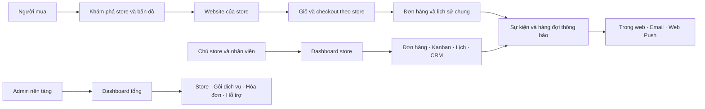

# Fleur — Kế hoạch chuyển sang nền tảng nhiều cửa hàng

Ngày lập: 18/10/2026. Múi giờ nghiệp vụ mặc định: Asia/Ho_Chi_Minh. Tiền tệ giai đoạn đầu: VND.

Đây là bản thiết kế gốc, bao gồm cả hướng mở rộng. Phần SaaS lõi đã được triển khai trên branch `codex/saas-platform`; database local đã được backup, thử restore và migration. Đối chiếu chức năng, kết quả kiểm thử và phần chưa phát hành tại [SAAS-VERIFICATION.md](SAAS-VERIFICATION.md). Các mục đề xuất trong tài liệu này không tự có nghĩa là tất cả đã hoàn thành hoặc được đo trên production; TiDB/Vercel production chưa được chuyển sang bản SaaS.

## 1. Định hướng sản phẩm và quyết định nền tảng

Fleur sẽ có ba không gian: khám phá và mua hoa trên toàn nền tảng; website và quản lý riêng của mỗi store; dashboard vận hành nền tảng. Một tài khoản có thể đồng thời là người mua và thành viên của nhiều store.

Các mặc định dùng để lập kế hoạch:

- Một store là một đơn vị dữ liệu độc lập. Giai đoạn đầu mỗi store có một địa điểm xuất phát; schema có `store_locations` để nâng cấp nhiều chi nhánh sau.
- Một checkout tạo đơn cho một store. Có thể giữ nhiều giỏ riêng theo store, mỗi lần thanh toán chỉ xử lý một giỏ.
- Tiền đơn hoa do store tiếp nhận theo phương thức được bật; trước mắt tiếp tục COD. Phí SaaS do nền tảng thu từ store theo luồng hóa đơn riêng. Chưa đưa chia tiền và đối soát nhiều người bán vào bản đầu.
- Người mua dùng chung danh tính toàn nền tảng; CRM, ghi chú, phân nhóm và đồng ý nhận marketing được lưu riêng từng store.
- URL store ban đầu là `/s/{storeSlug}` trên một domain để đơn giản hóa đăng nhập và PWA. Chuẩn bị bảng domain cho subdomain/custom domain ở giai đoạn sau.
- Store mới có thể tự đăng ký và dựng bản nháp. Chỉ store được duyệt, đủ cấu hình và được phép nhận đơn mới xuất hiện là có thể mua.
- Dashboard store giữ các nhóm quyền hiện có và bổ sung chủ sở hữu. Quyền nền tảng được cấp riêng; không suy ra từ email có chữ `admin` hoặc từ role admin của store.
- Cả hai cách giao hoa đều giữ lời nhắn ở bước 3. Gửi đến người bạn thương đứng trước và là mặc định; Giao cho tôi lấy tên, điện thoại từ người đặt và không lặp lại hai ô này.
- Chương trình tích điểm/giữ chuỗi là phần mở rộng sau khi dữ liệu đơn và consent đã tách theo store. Chưa tự bật chương trình cho mọi store.

## 2. Kết quả nghiên cứu và phần áp dụng

Khảo sát dựa trên tài liệu chính thức công khai, không phải kiểm thử dashboard có đăng nhập của các nhà cung cấp. Các bổ sung ở cột cuối là đề xuất cho Fleur.

| Tham khảo | Điểm được xác nhận | Cách áp dụng cho Fleur |
| --- | --- | --- |
| [Shopify: phân tích nhiều store](https://help.shopify.com/en/manual/organization-settings/analytics) | Có tổng hợp và so sánh dữ liệu giữa store, với quyền xem cấp tổ chức | Dashboard tổng có bộ lọc store, vùng, kỳ; từ số tổng mở được danh sách đóng góp |
| [Shopify: nhóm quyền](https://help.shopify.com/en/manual/your-account/users/roles/role-categories) | Quyền tổ chức và quyền store có phạm vi riêng | Tách platform membership khỏi store membership; một người có quyền khác nhau ở các store |
| [Shopify: giao hàng địa phương](https://help.shopify.com/en/manual/fulfillment/setup/delivery-methods/local-delivery) | Vùng giao có thể dựa trên bán kính/khu vực và quy tắc giá | Store cấu hình vùng giao, phí, tối thiểu và miễn phí; checkout kiểm tra lại địa chỉ nhận |
| [Floranext: Calendar Manager](https://floranext.com/whats-new-calendar-manager-on-advanced-point-of-sale/) | Đơn, giao hàng và đề xuất cùng xuất hiện trên lịch; chọn ngày mở quản lý giao hàng | Lịch lấy ngày giao làm trục, có đơn và ghi chú; bấm ngày mở danh sách đầy đủ |
| [HoneyBook: pipeline](https://help.honeybook.com/en/articles/2463528-customize-your-pipeline-in-honeybook) | Có giai đoạn, chế độ xem và tự động chuyển giai đoạn theo hoạt động | Kanban có bộ lọc đã lưu; trạng thái vận hành chuẩn; yêu cầu sự kiện lớn có pipeline riêng |
| [Sharetribe: Console](https://www.sharetribe.com/help/en/articles/8501778-how-sharetribe-console-works) | Công cụ điều hành marketplace quản lý users, listings, transactions | Dashboard tổng quản lý store, tài khoản, nội dung, giao dịch và hỗ trợ với đường dẫn liên quan |
| [Sharetribe: quản lý người dùng](https://www.sharetribe.com/help/en/articles/9230296-manage-users) | Tìm kiếm, lọc, các action hỗ trợ và liên kết tới giao dịch/nội dung | Hồ sơ merchant 360° và buyer 360°; action có quyền và audit, không mặc định sao chép action xóa của nền tảng khác |
| [Stripe: subscription lifecycle](https://docs.stripe.com/billing/subscriptions/overview) | Subscription, hóa đơn, thanh toán và quyền dùng tính năng có vòng đời liên quan | Thiết kế sẵn plan, giá, kỳ hạn, hóa đơn, entitlement; nhà cung cấp thanh toán sẽ nối qua adapter |

Không dùng doanh số bán hoa làm doanh thu SaaS. Không dùng pipeline tùy ý của công việc để thay đổi tùy ý trạng thái thực hiện đơn, vì các trạng thái này còn ảnh hưởng tồn kho, thanh toán và email.

## 3. Hiện trạng source và phần cần chuyển đổi

| Khu vực hiện tại | Phát hiện từ source | Thay đổi cần có |
| --- | --- | --- |
| `lib/auth.ts`, `lib/types.ts` | `users.role` là một role toàn cục; `requirePermission(area)` chưa có store | Giữ danh tính chung, chuyển quyền store sang memberships; kiểm tra scope ở server |
| `app/[[...slug]]/page.tsx`, `components/store.tsx` | Route tập trung cho một website; metadata dùng catalog chung | Tách layout marketplace/store/workspace/platform; metadata theo store và nội dung |
| `lib/catalog.ts`, `lib/db.ts` | Query và cache sản phẩm, danh mục, bài viết, sự kiện dùng chung | Mọi truy vấn và cache key/tag cần store ID; danh mục public không lấy dữ liệu store khác |
| `components/context.tsx` | Local storage `fleur.cart`, `fleur.wishlist`; cart item chưa có store | Giỏ theo store, wishlist tham chiếu store; chuyển đổi dữ liệu local cũ có phiên bản |
| `lib/commerce.ts` | Giá size S/M/L theo hệ số; phí giao 35.000đ hoặc miễn phí từ 1 triệu; slot cố định | Chính sách giao, biến thể, hạn chót đặt, ngày nghỉ và sức chứa theo store |
| `lib/admin.ts` | Tổng doanh thu đã giao và đồ thị đơn chưa hủy dùng định nghĩa khác nhau | Chuẩn hóa tên và công thức chỉ số; thêm scope, phân trang và rollup |
| `scripts/setup-db.mjs` | Slug, mã giảm giá, CRM email unique toàn hệ thống; chưa có tenant | Đổi unique theo store; backfill dữ liệu hiện có sang Fleur store đầu tiên |
| `lib/notifications.ts` | Feed suy ra từ 30 bản ghi mới của từng nguồn, quyền global | Inbox bền vững, read state trên server, scope store và đối tượng nhận |
| `lib/email.ts`, các bảng email | SMTP cấu hình chung; đã có outbox, dedupe, lease và xử lý tình huống không chắc đã gửi | Tái sử dụng cơ chế, bổ sung store/channel/preference, quota và template version |
| `vercel.json` | Worker email cron hiện chạy một lần/ngày | Cần worker/queue được kích hoạt phù hợp cho trạng thái đơn và nhắc lịch |
| `lib/product-blob.ts` | Upload dùng store Blob BLD, không fallback sang portfolio-blob | Giữ BLD; thêm ownership từng asset, prefix store và quota. Không tác động Blob dự án khác |
| `app/layout.tsx` | Metadata toàn website, robots hiện chặn index | SEO cho store đã công bố; admin/checkout/preview tiếp tục không index |
| Toàn dự án | Chưa có Google login, manifest/service worker/push | Bổ sung sau khi định danh và scope store thống nhất |

Phát hiện dựa trên source, chưa đối chiếu schema và dữ liệu production đang chạy. Trước migration cần xác nhận schema thực tế, TiDB cluster/version, volume dữ liệu và backup phục hồi được.

## 4. Danh tính, Google login và chuyển trang sau đăng nhập

### 4.1 Danh tính và tài khoản

- `users` là tài khoản nền tảng. Có thể có mật khẩu, Google identity, hoặc cả hai. Tài khoản chỉ Google không cần mật khẩu giả.
- `auth_identities` lưu provider và subject; unique `(provider, subject)`. Với Google dùng `sub`, không dùng email làm khóa nhận diện lâu dài. Theo [Google OpenID Connect](https://developers.google.com/identity/openid-connect/openid-connect), `sub` là định danh phù hợp ngay cả khi email thay đổi.
- Luồng Google dùng thư viện OIDC được duy trì, kiểm tra issuer, audience, chữ ký, thời hạn, state/nonce và PKCE phù hợp luồng. Không tự tin vào profile Google gửi từ client.
- Email trùng tài khoản đã có mật khẩu: yêu cầu đăng nhập tài khoản cũ rồi liên kết; không tự ghép tài khoản chỉ vì trùng email. Hỗ trợ hủy liên kết khi vẫn còn phương thức đăng nhập khác.
- OAuth chỉ đăng nhập. Việc cấp quyền nền tảng, nhận lời mời store, tạo store và đồng ý marketing là hành động riêng.
- Giữ đăng nhập email/mật khẩu, bổ sung xác minh email và hoàn thiện khôi phục mật khẩu bằng token hết hạn, dùng một lần. Luồng quên mật khẩu hiện tại gửi yêu cầu hỗ trợ cần được thay thế.
- Store owner/platform admin có thiết kế cho xác thực tăng cường khi đổi chủ sở hữu, quyền, thông tin thanh toán; platform admin bật MFA trước khi mở vận hành rộng.

### 4.2 Điều hướng có ngữ cảnh

Thứ tự xử lý sau khi xác thực:

1. Nếu đang nhận lời mời: xác minh đúng tài khoản/email, hoàn tất membership rồi mở workspace được mời.
2. Nếu có hành động đang làm và `returnTo` hợp lệ: trở lại trang đó, kể cả khi người mua đồng thời là admin store. Không tự chuyển merchant ra khỏi checkout đang làm.
3. Nếu không có ngữ cảnh: platform admin vào `/platform`; thành viên một store vào workspace và trang đầu tiên mình có quyền; nhiều store vào bộ chọn workspace; buyer vào `/`.
4. Người đang mở store mới trở lại bước onboarding chưa hoàn tất.

`returnTo` chỉ cho đường dẫn nội bộ thuộc các route được phép, kiểm tra quyền đích ở server; chặn URL ngoài, URL dạng `//`, vòng lặp đăng nhập và đường dẫn không còn tồn tại. Google callback dùng context có ký hoặc lưu server-side; không nhận tùy ý role/store từ query string.

Không tiếp tục giữ cơ chế chỉ có một `APP_ORIGIN` nếu nâng cấp custom domain. Bản đầu dùng một origin; bản custom domain bổ sung registry domain đã xác minh, chính sách CSRF và OAuth callback tại domain nền tảng.

## 5. Phân quyền theo store và nền tảng

`admin@platform` được hiểu là nhóm quyền `platform_admin`. Đây không phải email được đăng ký công khai để tự nhận quyền. Tài khoản quản trị tổng được gán qua quy trình bootstrap riêng dựa trên user ID đã xác minh và audit.

| Vai trò | Phạm vi | Quyền chính |
| --- | --- | --- |
| Buyer | Cá nhân | Hồ sơ, địa chỉ, đơn của mình, wishlist, đánh giá, preference |
| Store owner | Các store mình sở hữu | Toàn bộ vận hành, billing, nhân sự, chuyển chủ, công bố giao diện |
| Store admin | Store được cấp | Quản trị store và nhân sự dưới giới hạn được giao; không đổi chủ hoặc đóng store mặc định |
| Manager | Store được cấp | Sản phẩm, đơn, giao hàng, CRM, báo cáo và chiến dịch theo quyền |
| Editor | Store được cấp | Bài viết, sự kiện, nội dung; không xem toàn bộ dữ liệu khách hoặc thanh toán |
| Support | Store được cấp | Đơn, yêu cầu hỗ trợ, CRM được phép; quyền hủy/hoàn tiền tách riêng |
| Platform admin | Nền tảng | Duyệt và quản lý store, gói, hóa đơn SaaS, vận hành, cấu hình và quyền platform |
| Platform support/analyst/billing | Nền tảng, khi mở rộng | Hỗ trợ, báo cáo hoặc hóa đơn theo phạm vi; hạn chế dữ liệu và action nhạy cảm |

Các role cũ được chuyển thành preset trong store Fleur. Lập bảng đối chiếu từng quyền trước migration; không tự mở rộng quyền cũ vì thêm màn hình mới.

Permission chi tiết có thể gồm `orders.read`, `orders.transition`, `orders.cancel`, `orders.reschedule`, `payments.record`, `refunds.approve`, `crm.export`, `campaigns.send`, `theme.publish`, `members.manage`, `billing.manage`. Menu ẩn theo quyền chỉ phục vụ UI; API bắt buộc kiểm tra quyền ở mỗi request.

Quy tắc nhân sự:

- Invite có token một lần, hạn sử dụng, trạng thái pending/accepted/revoked/expired. Có action gửi lại và thu hồi.
- Một user có thể manager ở store A, editor ở store B và mua ở store C.
- Không xóa hoặc hạ quyền người owner cuối cùng. Chuyển owner cần người nhận chấp thuận và xác thực lại người chuyển.
- Store chỉ quản lý membership của nhân viên và trạng thái quan hệ khách tại store; không khóa tài khoản nền tảng của buyer.
- Thu hồi membership làm mất quyền ngay, gồm API, feed thông báo và các action đang mở; session không được đóng băng quyền cũ suốt bảy ngày.
- Platform support xem store qua context rõ ràng có audit. Nếu bổ sung chế độ hỗ trợ thay mặt chủ store, mặc định chỉ đọc, có thời hạn, banner nhận diện và quyền riêng cho ghi dữ liệu.

## 6. Store onboarding và vòng đời

Luồng tạo store: đăng nhập → chọn “Mở cửa hàng” → tên/slug/logo → thông tin liên hệ → địa chỉ/pin bản đồ → giờ hoạt động, vùng giao, ngày nghỉ, slot và sức chứa → chọn template → tạo ít nhất một sản phẩm bán được → xem trước → gửi duyệt → công bố.

Wizard lưu nháp từng bước, hiển thị phần còn thiếu, quay lại tiếp tục được. Kiểm tra slug trùng và các slug dành riêng; không tự sao chép dữ liệu hoặc SMTP từ store khác.

Tách ba nhóm trạng thái:

| Nhóm | Trạng thái đề xuất | Ý nghĩa |
| --- | --- | --- |
| Xét duyệt store | draft / pending_review / approved / rejected / suspended / archived | Có được công bố và giao dịch trên nền tảng hay không |
| Hoạt động | open / scheduled / temporarily_closed | Giờ làm, tạm ngưng, có nhận đặt trước hay không |
| Dịch vụ SaaS | free / trialing / active / past_due / restricted / cancelled | Quyền dùng gói, kỳ hạn và công nợ |

“Đang đóng cửa” không đồng nghĩa không xuất hiện: store có thể nhận đơn giao ngày sau. Homepage đánh giá khả năng phục vụ theo địa chỉ và thời điểm được chọn. Store bị đình chỉ/hết quyền nhận đơn thì không tạo đơn mới; vẫn có đường xử lý đơn đã nhận, khiếu nại và lịch sử theo quyền.

Actions store ở dashboard tổng: duyệt, yêu cầu bổ sung, từ chối kèm lý do, tạm đình chỉ/khôi phục, ẩn khỏi khám phá, cho phép/tắt nhận đơn mới, đổi gói/kỳ dùng thử, quản lý quota, xem vận hành, liên hệ chủ store, hỗ trợ chuyển chủ, xuất dữ liệu và lưu trữ. Đóng store phải kiểm tra đơn đang mở, nghĩa vụ hoàn tiền/công nợ và lưu lịch sử.

## 7. Homepage marketplace, Goong và địa chỉ giao

### 7.1 Bố cục và tương tác

- Header có “Giao đến”, tìm store/hoa/dịp, ngày và khung giờ dự kiến, chuyển Danh sách/Bản đồ.
- Nội dung chính: store phục vụ địa chỉ đã chọn; giao trong ngày; store đã mua/theo dõi; gợi ý theo dịp. Store card có cover/logo, tên, khu vực, khoảng cách, khoảng giá, điều kiện giao và thời điểm sớm nhất có thể nhận.
- Rating chỉ hiện từ đánh giá thực tế sau đơn hoàn tất. Store mới hiện nhãn mới, không tạo điểm đánh giá giả. Vị trí quảng bá nếu có phải được nhận diện.
- Chọn card hoặc marker mở cùng một store; giữ bộ lọc, vị trí và vị trí cuộn khi quay về.
- Desktop: list và map cạnh nhau. Mobile: chuyển tab hoặc bottom sheet, có nút “Tìm trong khu vực này”; tránh tự tải lại liên tục khi kéo bản đồ.

### 7.2 Vị trí người mua và người nhận

Khách có thể mua tặng ở tỉnh khác với nơi họ đang đứng. Trục tìm store mặc định là “Giao đến”; GPS chỉ là một cách điền địa chỉ. Lần đầu không chặn toàn bộ homepage để bắt quyền GPS: cho chọn tỉnh/khu vực hoặc tìm địa chỉ thủ công. Nếu chưa chọn, ghi rõ đang xem khu vực gợi ý.

Thay địa chỉ nhận ở checkout làm tính lại phí, vùng giao, slot và giá quote. Nếu không phục vụ được, giữ form và gợi ý store phù hợp; không gửi đơn với địa chỉ cũ. Địa chỉ gồm nội dung hiển thị, lat/lng, place ID khi có và ghi chú như số nhà/tầng; có cách sửa pin khi geocode không chính xác.

### 7.3 Kỹ thuật và trải nghiệm lỗi

Tham khảo trực tiếp `C:\laragon\www\toigibando`: `src/components/app.tsx` (Home), `chef-map.tsx`, `address-picker.tsx`, `src/lib/location-client.ts`, `goong.ts` và `docs/chef-map.md`. Áp dụng cách liên kết marker/list, tải SDK khi cần, giữ dữ liệu đang hiển thị khi refresh và danh sách vẫn hoạt động khi map lỗi. Điều kiện nhận đơn phải được viết lại theo sản phẩm hoa và lịch phục vụ, không sao chép các điều kiện bữa ăn.

- Dùng Maptiles key cho hiển thị và REST API key cho dịch vụ địa điểm theo [hướng dẫn Goong](https://help.goong.io/kb/uncategorized/dang-ky-tai-khoan-va-tao-key/). REST key ở server; browser key giới hạn domain phù hợp.
- Autocomplete debounce, hủy request cũ, giới hạn tần suất, timeout và lỗi dễ hiểu. Chuẩn hóa response của phiên bản API được chọn, không trộn cấu trúc v1/v2. Có [Autocomplete v2 chính thức](https://help.goong.io/kb/rest-api-v2/autocomplete-rest-api-v2/autocomplete-v2/) để đánh giá khi tích hợp.
- Lọc thô bằng bounding box rồi tính khoảng cách địa lý trên tập ứng viên; không gọi Directions cho tất cả store trên mỗi lần gõ.
- Khoảng cách “gần” có thể là đường chim bay và phải ghi đúng. Nếu tính phí theo quãng đường, dùng quote tuyến đường được server xác nhận; không dùng hai loại khoảng cách thay thế lẫn nhau.
- Vùng giao bản đầu dùng bán kính và quy tắc phí rõ ràng theo store/location; polygon/khu vực là mở rộng. Nếu Maps lỗi vẫn cho xem store, nhưng chỉ cho đặt khi địa chỉ/vùng giao được xác nhận bằng dữ liệu tin cậy.
- Map hỗ trợ cluster/bounding box/phân trang khi nhiều store; API chỉ trả hồ sơ store đã công bố và tọa độ công khai. Không trả thông tin người nhận hay vị trí GPS của buyer.
- Ngân sách API, số lượt gọi và tỷ lệ lỗi được đưa vào dashboard kỹ thuật; cache tuân theo điều khoản nhà cung cấp được kiểm tra khi triển khai.

## 8. Giỏ hàng, đặt hoa, lịch sử và đặt lại

### 8.1 Giỏ theo store

Store A và B có giỏ độc lập. Trang `/cart` liệt kê các giỏ theo store và nút checkout từng store; trong storefront, badge chỉ rõ ngữ cảnh. Thêm sản phẩm khác store không âm thầm xóa giỏ cũ. Đăng nhập và chuyển workspace không làm mất giỏ. Logout dọn dữ liệu nhạy cảm, không giữ bản checkout có tên/số điện thoại trên thiết bị dùng chung.

API quote/checkout luôn có context store được resolve ở server, kiểm tra mọi product/variant/promotion thuộc store đó. Khách sửa ID trong request không thể mua sản phẩm store B trong đơn store A. Giá, tồn, khuyến mãi, phí và năng lực nhận đơn được tính lại ở server.

### 8.2 Checkout

Giữ bốn bước hiện tại với điều chỉnh:

1. Người đặt: tên, điện thoại, email; tài khoản đăng nhập được điền sẵn và xác minh theo luồng tài khoản.
2. Giao hoa: mặc định gửi người bạn thương; hoặc Giao cho tôi; địa chỉ, pin, ngày, slot. Thêm nhận tại cửa hàng khi store bật, có slot/sức chứa riêng.
3. Lời nhắn: có cho cả hai lựa chọn; nội dung thiệp và ghi chú nội bộ giao hàng tách rõ. Đề xuất thêm ẩn danh người tặng, chỉ dùng thông tin người đặt trong vận hành.
4. Thanh toán: phương thức store được bật; hiển thị tổng giá, phí, phụ thu, giảm giá và chính sách hủy/thay hoa.

Cho khách xem và thêm giỏ khi chưa đăng nhập. Bản đầu giữ checkout khách như luồng cũ; gợi ý đăng nhập Google để theo dõi. Đơn khách được tra bằng liên kết bảo mật/OTP phù hợp; gắn về tài khoản sau khi chứng minh quyền sở hữu, không tự gắn chỉ theo email nhập tay.

Quy tắc nghiệp vụ cần bổ sung:

- Store có lead time theo loại sản phẩm, cutoff cùng ngày, ngày nghỉ, số ngày cho phép đặt trước và lịch đặc biệt ngày lễ.
- Slot có quota; giữ chỗ ngắn hạn khi bắt đầu xác nhận/thanh toán nếu cần. Tạo đơn thành công giữ năng lực và tồn kho; request đồng thời không vượt quota. Reservation hết hạn được giải phóng bởi worker; đơn xác nhận COD không tự hết hạn như reservation thanh toán.
- Thời điểm chưa đủ khả năng giao phải gợi ý slot khác. Kiểm tra cả ngày thật trong lịch và giờ hiện tại ở Việt Nam, không chỉ regex và ngày >= hôm nay.
- Quote có phiên bản/hiệu lực. Giá hay slot đổi trước khi đặt thì yêu cầu người mua xem lại, không âm thầm đổi tổng tiền.
- `idempotencyKey` gắn với store và chủ giỏ/phiên checkout; nhấn hai lần không tạo hai đơn. Kiểm tra ownership, không dựa vào email làm bằng chứng duy nhất.
- Giữ snapshot tên store, liên hệ, sản phẩm/biến thể, ảnh, giá, vùng/phí giao, địa chỉ và chính sách ở thời điểm đặt. Thay giao diện/tên/sản phẩm sau này không viết lại lịch sử.
- Hủy đơn phục hồi tồn/quota đúng một lần; hoàn tiền là quy trình riêng, có người thực hiện và bằng chứng.

### 8.3 Lịch sử và đặt lại

`/account/orders` tổng hợp đơn của user ở mọi store; có filter store, trạng thái, thời gian và tìm mã. Card/detail có tên/logo store, đường dẫn store, trạng thái, lịch giao, thanh toán, các mặt hàng, timeline và yêu cầu hỗ trợ gắn với đơn.

Đơn giao thành công có “Đặt lại”. Action chỉ chuẩn bị giỏ của chính store đó: kiểm tra store đang nhận đơn, sản phẩm/size còn bán, tồn, giá hiện tại; báo những mục không thể thêm. Không sao chép mã giảm giá đã hết hiệu lực, lịch giao cũ hoặc tự tạo đơn. Người mua chọn lại ngày/địa chỉ và xác nhận giá. Nếu giỏ đã có hàng, hiển thị lựa chọn gộp/thay thế trước khi thay đổi.

Theo dõi store và đánh giá sau mua được đưa vào luồng hoàn tất. Mua lại hoặc đánh giá không tự đăng ký marketing.

## 9. Dashboard store: bảng, Kanban, lịch và CRM

### 9.1 Một nguồn dữ liệu đơn, ba chế độ xem

Bảng / Kanban / Lịch cùng sử dụng API đơn có filter theo ngày giao, trạng thái, người phụ trách, thanh toán và tag. URL lưu bộ lọc; mở detail bằng drawer, đóng drawer vẫn giữ vị trí. Có phân trang theo cột và tải theo khoảng ngày, không lấy 500 đơn rồi giả định đầy đủ.

Luồng thực hiện chuẩn:

`pending → confirmed → preparing → ready → shipping → delivered`

`pending/confirmed → cancelled` theo quyền/chính sách. Các tình huống `delivery_failed` hoặc `on_hold` được theo dõi như ngoại lệ có lý do và bước xử lý; không tùy ý kéo đơn đã giao quay lại đang làm. Xác nhận lại đơn hủy là đơn/luồng mới.

Thanh toán có state riêng: unpaid / pending / paid / partially_refunded / refunded / failed, cùng sổ giao dịch. “Đã giao” không tự đảm bảo đã thu tiền. COD cần action xác nhận đã thu; UI có thể gộp hành động khi giao nhưng phải ghi riêng người xác nhận, số tiền và thời điểm.

### 9.2 Kanban

- Card: mã đơn, giờ giao, khoảng thời gian còn lại/quá hạn, sản phẩm chính, số lượng, khu vực, thanh toán, người phụ trách, tag và cảnh báo thiếu thông tin.
- Màu trạng thái có nhãn/icon; tag nghiệp vụ như “hoa cưới”, “giao gấp” dùng bảng màu khác. Không dùng màu làm dấu hiệu duy nhất.
- Kéo thả chỉ vào bước hợp lệ; cần lý do khi hủy/giữ đơn hoặc điều chỉnh ngoại lệ. Mobile/bàn phím có nút chuyển trạng thái, không phụ thuộc kéo thả.
- Lưu trạng thái bằng API transition chung, check permission + store + version + điều kiện thanh toán/giao. Khi lỗi, card trở về vị trí cũ và thông báo nguyên nhân.
- Hai nhân viên sửa cùng đơn: request mang version, người đến sau nhận xung đột và dữ liệu mới. Trạng thái không bị ghi đè im lặng; retry không nhân đôi email/hoàn tồn.
- SLA do store cấu hình: thời gian chờ xác nhận, thời gian chuẩn bị, sát giờ giao. Cảnh báo là badge/thông báo, không tự hủy đơn mà chưa có quy tắc.
- Live update ưu tiên trong workspace đang mở; polling có cursor/focus refresh là bản đầu, provider realtime có thể thêm sau. Không giữ kết nối DB lâu chỉ để chờ sự kiện.

### 9.3 Lịch giao và ghi chú

- Desktop có tháng/tuần/ngày; mobile ưu tiên agenda theo ngày, vẫn có chọn ngày nhanh.
- Đơn xuất hiện theo ngày/slot giao, không theo ngày tạo. Slot chưa phải phút giao chính xác; nhãn phải phản ánh đúng khoảng giờ.
- Ô ngày hiển thị tổng đơn, còn chỗ/đã đầy, tiền dự kiến thu và vài tag; “+N đơn” mở toàn bộ đơn của ngày, không cắt mất đơn đông.
- Click ngày mở panel gồm các slot, đơn, người phụ trách, note và task; click đơn mở drawer đầy đủ. Nội dung thiệp/điện thoại không phơi ra trực tiếp trên lịch tổng quan.
- Note nội bộ có tiêu đề, nội dung, màu/tag, khoảng thời gian, người phụ trách và tùy chọn gắn order/customer. Phân biệt note với đơn để không tính note vào doanh số hoặc quota.
- Đổi lịch đơn phải kiểm tra cutoff, quota và vùng giao; hiển thị thay đổi phí nếu có; sau khi lưu mới gửi thông báo. Bản đầu dùng action “Đổi lịch” trong drawer để hạn chế thao tác nhầm; kéo lịch là nâng cấp sau cùng quy trình.
- [FullCalendar eventDrop](https://fullcalendar.io/docs/eventDrop) hỗ trợ trả UI về trước thao tác khi lưu lỗi. Đề xuất đánh giá Standard cho month/week/day/list; [Standard dùng MIT, Premium có điều kiện riêng](https://fullcalendar.io/license), chưa mặc định dùng resource scheduler trả phí.

### 9.4 CRM store và vận hành hoa

- Hồ sơ khách: lịch sử chỉ tại store, số đơn đã giao, chi tiêu sau hoàn tiền, lần mua gần nhất, dịp quan trọng, sở thích được khách cung cấp, note, task, ticket, email/push đã gửi và consent.
- Segments: mới, quay lại, VIP, sắp tới dịp, lâu chưa mua; tiêu chí cấu hình và xem được số khách thực tế trước khi gửi.
- Automation: chào mừng sau lần mua đầu, chăm sóc sau giao, xin đánh giá, nhắc dịp và ưu đãi quay lại. Có điều kiện, thời gian chờ, tần suất tối đa, chống gửi trùng và preview người nhận; không gửi sau khi đã rút consent.
- Người nhận quà không tự thành contact marketing. Store A không nhìn thấy đơn, note, chi tiêu hoặc consent của store B.
- Inbox hỗ trợ gắn store/customer/order, có người phụ trách và hạn phản hồi. Ticket vận hành store và ticket store hỏi nền tảng là hai scope khác nhau.
- In phiếu chuẩn bị/thiệp/giao hàng theo quyền; export có bộ lọc, giới hạn, audit và bảo vệ nội dung CSV.
- Theo mùa/ngày lễ: lịch phụ thu, tạm khóa slot, batch danh sách chuẩn bị. Nâng cấp sau có định mức nguyên liệu, tồn hoa theo lô/hạn tươi và đề xuất thay hoa cần khách chấp thuận.
- Yêu cầu cưới/sự kiện lớn có luồng lead → tư vấn → báo giá → chấp thuận → đặt cọc → thực hiện. Tách khỏi checkout bó hoa để không làm rối bảng đơn; triển khai sau vận hành cơ bản.

## 10. Dashboard tổng và CRM cho store

| Mục | Phân tích/hiển thị | Actions và drill-down |
| --- | --- | --- |
| Tổng quan | Store đăng ký/được duyệt/đang bán; đơn, doanh số hoa, SaaS, nợ; so kỳ | Mỗi card mở danh sách đúng filter; xem độ mới dữ liệu |
| Stores | Trạng thái duyệt, khu vực, owner, gói, ngày hoạt động cuối, sức khỏe vận hành | Duyệt/yêu cầu bổ sung/tạm dừng/khôi phục; hồ sơ 360° |
| Đơn và chất lượng | Thời gian xác nhận, giao đúng hẹn, tỷ lệ hủy/giao lỗi, ticket/đơn | Tra cứu đơn có scope; hỗ trợ sự cố; xem audit và nguyên nhân |
| SaaS và hóa đơn | Trial sắp hết, MRR, churn, hóa đơn đến hạn/quá hạn, thu thực tế | Gói, gia hạn, đổi gói, xác nhận tiền, gửi lại hóa đơn, credit/void có lý do |
| Merchant CRM | Lead mở store, onboarding bỏ dở, chưa có đơn, nguy cơ ngừng dùng | Owner phụ trách, note/task, lịch chăm sóc, chiến dịch merchant |
| Khách mua | Người mua mới/quay lại, funnel, tổng số người duy nhất | Hồ sơ theo quyền, khiếu nại, kiểm soát truy cập dữ liệu từng store |
| Nội dung và khám phá | Store/sản phẩm được công bố, banner, chiến dịch, đánh giá | Duyệt nội dung bị báo cáo, quản lý vị trí nổi bật, lịch công bố |
| Hỗ trợ | Ticket merchant/buyer, SLA, tồn đọng, lý do thường gặp | Phân công, ưu tiên, trao đổi, escalations, liên kết store/order |
| Tích hợp và hệ thống | Queue lag, email lỗi, push lỗi, Maps quota/lỗi, upload, API/DB latency | Retry có kiểm soát, ngưng chiến dịch lỗi, quota, trạng thái dịch vụ |
| Quản trị | Quyền platform, audit, template gốc, feature flags và cấu hình | Invite/thu hồi quyền, xem thay đổi, rollout tính năng theo nhóm store |

Store 360° có các tab: hồ sơ/xét duyệt; owner và nhân sự; hiệu suất; đơn và sự cố; subscription/hóa đơn; CRM/task/ticket; template/domain/tích hợp; quota/audit. Mọi action có trạng thái thành công/thất bại và lịch sử, thay vì chỉ có nút sửa/xóa chung.

Merchant CRM theo dõi quan hệ nền tảng với chủ store. CRM store theo dõi quan hệ cửa hàng với khách mua. Không dùng chung segment hoặc danh sách gửi của hai mục này.

## 11. Chỉ số và cách tính

| Chỉ số | Định nghĩa dùng trong thiết kế |
| --- | --- |
| Giá trị đơn tạo | Tổng giá trị đơn theo created_at; hiển thị rõ hủy/đang xử lý, không gắn nhãn đã thu |
| Doanh số hoa hoàn tất | Giá trị đơn delivered theo completed_at; tách hàng, giảm giá, phí giao và số hoàn tiền |
| Tiền đã thu | Tổng giao dịch thu thành công trừ giao dịch hoàn; dùng sổ thanh toán, không suy từ trạng thái giao |
| AOV | Doanh số đơn hoàn tất theo định nghĩa đã chọn / số đơn tương ứng; hiển thị công thức và khoảng thời gian |
| Tỷ lệ hủy | Số đơn hủy / số đơn trong cùng cohort thời gian tạo, ghi nhận thời điểm chốt báo cáo |
| Giao đúng hẹn | Đơn có delivered_at không muộn hơn cuối slot đã cam kết / đơn đã giao có đủ dữ liệu lịch |
| Tỷ lệ chuyển đổi | Phiên đủ điều kiện có tạo đơn / phiên đủ điều kiện; cần event/session thật và loại trừ bot/test |
| Khách quay lại | Khách đã có đơn delivered trước kỳ và tiếp tục có đơn trong kỳ; scope store hoặc platform được ghi rõ |
| Store kích hoạt | Store công bố, có sản phẩm mua được, cấu hình giao đầy đủ; theo dõi thêm mốc đơn đầu tiên |
| MRR | Phí thuê định kỳ đang hiệu lực quy đổi tháng, trừ ưu đãi định kỳ; không cộng phí giao, GMV hoặc khoản một lần |
| Churn store trả phí | Store kết thúc subscription trả phí trong kỳ / store trả phí đầu kỳ; tách khỏi store tạm đóng cửa |
| Công nợ SaaS | Số còn phải thu của hóa đơn đã phát hành và đến hạn; không dùng toàn bộ giá trị invoice đã paid |

Nguồn sự thật của tiền là đơn snapshot và payment/refund ledger; của trạng thái là event có version; của truy cập là analytics events. Client events không được tạo ra số doanh thu chính thức.

Bổ sung `completed_at`, `confirmed_at`, `shipped_at`, committed slot snapshot và status events để tính các chỉ số. Dữ liệu cũ thiếu timestamp không được bịa ngày: đánh dấu thiếu hoặc áp dụng báo cáo hạn chế có chú thích. Mọi biểu đồ có kỳ so sánh, store, timezone, filter, export và “cập nhật lúc”.

Instrumentation đề xuất: discovery_view, store_view, product_view, add_to_cart, checkout_started, order_created, store_onboarding_step, store_published, first_order_delivered, subscription_activated/cancelled. Dedupe theo event ID, version schema; không ghi lời nhắn, tên/điện thoại/địa chỉ chính xác vào analytics.

## 12. Base thu phí store theo tháng

### 12.1 Domain billing

- Plan mô tả tính năng; plan price có tiền tệ, chu kỳ, số tiền và version. Đổi bảng giá không sửa hóa đơn đã phát hành hoặc tự đổi giá hợp đồng cũ.
- Subscription lưu store, giá đang dùng, trạng thái, trial, kỳ hiện tại, ngày gia hạn, cancellation và grace period.
- Hóa đơn gồm kỳ dịch vụ, line item snapshot, giảm trừ/credit, số phải thu, đã thu, hạn thanh toán và liên kết chứng từ. Cần lựa chọn tích hợp hóa đơn điện tử riêng khi triển khai nghiệp vụ đó; PDF nội bộ không được gọi là chứng từ thuế tự động.
- Payment attempts/payment ledger lưu trạng thái, mã đối tác, thời điểm và người xác nhận nếu thủ công. Mã giao dịch đối tác unique; retry/webhook trùng không ghi hai lần.
- Entitlements kiểm tra ở server: số nhân viên, số sản phẩm, dung lượng ảnh, chiến dịch, template/domain, quota API. Downgrade vượt quota thì hạn chế thêm mới và hướng dẫn điều chỉnh, không xóa dữ liệu tự động.

### 12.2 Vòng đời và actions

Đăng ký gói → trial/free hoặc chờ thanh toán → active → đến kỳ tạo hóa đơn → đã thu tiếp tục active; chưa thu chuyển past_due/grace → restricted theo chính sách → khôi phục khi thanh toán hoặc cancelled cuối kỳ.

Bản đầu có thể vận hành hóa đơn và xác nhận chuyển khoản thủ công có audit; base có adapter để tích hợp cổng thanh toán sau. Không mặc định rằng bất kỳ cổng nào cũng hỗ trợ trích tiền tháng. Chọn provider cần kiểm tra khả năng recurring, doanh nghiệp nhận tiền và VND ở thời điểm triển khai.

Actions: chọn/đổi gói; gia hạn; tăng/giảm quota; gia hạn trial; hủy cuối kỳ/khôi phục trước hạn; lịch sử invoice; tải và gửi lại hóa đơn; ghi nhận thu; credit/void/refund theo quyền; nhắc hạn; ghi lý do điều chỉnh. Nâng gói và prorate cần preview; bản đầu có thể áp dụng đổi gói ở đầu kỳ tiếp theo để giảm sai lệch.

Tách quyền nhận đơn mới khỏi quyền hoàn tất đơn cũ. Quá hạn SaaS không làm mất khả năng xử lý giao hàng, trả lời hỗ trợ, xem billing và xuất dữ liệu được phép. Đóng store và hủy subscription là hai action liên quan có kiểm tra, không đồng nhất bằng một boolean.

[Stripe lifecycle](https://docs.stripe.com/billing/subscriptions/overview) là nguồn tham khảo mô hình; kế hoạch này chưa chọn Stripe làm nhà cung cấp thanh toán cho Fleur.

## 13. Năm template và tùy chỉnh

| Template | Bố cục và định hướng |
| --- | --- |
| Fleur Minimal | Kế thừa giao diện trắng đen hiện tại, khoảng trắng rộng, sản phẩm rõ |
| Editorial | Ảnh lớn, câu chuyện studio, bộ sưu tập và bài viết |
| Botanical | Tông thiên nhiên, lưới sản phẩm, nội dung chăm sóc hoa |
| Atelier | Dịch vụ cao cấp, portfolio cưới/sự kiện, form yêu cầu tư vấn |
| Everyday | Tập trung danh mục, giao nhanh, ưu đãi và mua lại, tối ưu mobile |

Các template khác nhau ở bố cục và module trang chủ, đồng thời dùng chung chức năng catalog, gallery, checkout và tài khoản. Theme không được tự thay đổi giá, quyền hoặc nghiệp vụ đơn.

Store chỉnh logo/favicon/cover, palette màu nền/chữ/accent, font heading/body, tỷ lệ khoảng cách, radius và các block có schema: hero, danh mục, sản phẩm nổi bật, collections, story, đánh giá, chính sách, liên hệ. Có bật/tắt và sắp xếp trong giới hạn template.

Editor có preview desktop/mobile, lưu nháp, publish nguyên phiên bản và khôi phục bản trước. Dữ liệu mẫu chỉ có trong preview; đổi template giữ nội dung đã nhập và báo block không tương thích. Font chọn từ danh sách đã chuẩn bị cho tiếng Việt và quyền sử dụng phù hợp; giữ system fallback cho SF. Bản đầu không cho chèn script/CSS tùy ý.

Theme tokens được scope theo storefront; không làm đổi màu dashboard, marketplace hay store khác. Có kiểm tra tương phản, cỡ chữ và ảnh cover; mỗi template đều có empty/error/loading state và kiểm thử checkout mobile.

## 14. PWA, mobile navigation và thông báo

### 14.1 PWA và navigation

- Một PWA nền tảng trên domain chính trong bản đầu: manifest, icon thường/maskable, standalone, start URL và offline page. Store vẫn có giao diện riêng trong PWA; nhiều PWA theo custom domain là giai đoạn sau.
- Buyer mobile: Khám phá / Bản đồ / Giỏ hàng / Đơn hàng / Tài khoản. Inbox thông báo truy cập bằng chuông; có badge.
- Store mobile: Tổng quan / Đơn / Lịch / Thông báo / Thêm. Kanban nằm trong Đơn; role ít quyền chỉ thấy mục phù hợp. Có switch Mua hoa/Quản lý store.
- Platform mobile có điều hướng vận hành tối giản; các báo cáo lớn có bảng responsive và bộ lọc, desktop giữ dashboard đầy đủ.
- Bottom nav chừa safe area, không che nút đặt hàng, drawer hoặc bàn phím; quay lại giữ state. Hiệu ứng tôn trọng reduced motion và không chạy lại vì focus.
- Cache service worker giới hạn vào shell, tài nguyên public và dữ liệu phù hợp. Auth/CRM/admin/orders/payments/checkout không được trả từ shared offline cache. Logout hoặc đổi user/store phải xử lý cache đúng scope.
- Offline cho biết dữ liệu có thể cũ; có thể xem nội dung public đã lưu, nhưng tạo đơn/chuyển trạng thái/ghi tiền cần online. Không tự phát lại đơn hoặc action tài chính khi có mạng trở lại.

### 14.2 Inbox, email, toast và push

Một sự kiện nghiệp vụ sinh notification với recipients theo quyền, sau đó định tuyến tới các kênh được bật. Inbox/read state lưu ở server để dùng nhiều thiết bị; toast là cách hiển thị khi đang mở app, Web Push là kênh riêng khi rời app.

| Nhóm | Sự kiện | Đối tượng và điều kiện |
| --- | --- | --- |
| Giao dịch buyer | Tạo đơn, xác nhận, chuẩn bị, giao, hoàn tất, hủy/đổi lịch | Người đặt/chủ đơn; liên kết mở đúng đơn |
| Vận hành store | Đơn mới, slot gần đầy, giao trễ, ticket, thành viên mới | Membership còn hiệu lực và có permission tương ứng |
| Nền tảng → store | Duyệt store, trial/hóa đơn/gia hạn, sự cố hệ thống | Owner/billing/admin đúng store |
| Store → buyer | Chăm sóc sau mua, nhắc dịp, chương trình | Quan hệ đúng store và consent cho kênh/nhóm chương trình |
| Hệ thống → buyer | Bảo mật, thay đổi ảnh hưởng đơn/tài khoản | Đúng user và phạm vi sự kiện |

Đã từng mua hàng chỉ tạo điều kiện gợi ý theo dõi; không tự đồng ý nhận push/email khuyến mãi. Browser permission và consent marketing là hai trạng thái riêng. Có settings theo store, loại thông báo, channel, khung giờ yên lặng, tần suất và hủy đăng ký.

Push cần user chủ động bật. Theo [WebKit](https://webkit.org/blog/13878/web-push-for-web-apps-on-ios-and-ipados/), luồng Web Push truyền thống trên iOS/iPadOS 16.4+ yêu cầu web app được thêm Home Screen và thao tác trực tiếp để xin quyền; nghiệm thu trên thiết bị/phiên bản mục tiêu. Trình duyệt không hỗ trợ hoặc user từ chối vẫn dùng inbox/email. Không cam kết OS giao push đúng thời điểm hay luôn giao thành công.

Subscription push lưu theo user + thiết bị, binding scope và preference; một endpoint có thể nhận sự kiện của nhiều store theo quyền của user, không nhân bản đăng ký trình duyệt cho mỗi store. Logout gỡ binding tài khoản để thiết bị dùng chung không nhận đơn của người trước; response hết hạn thì dọn endpoint.

Payload push không chứa nội dung thiệp, địa chỉ đầy đủ hoặc dữ liệu nhạy cảm trên màn hình khóa. Click mở route đúng store/đơn; nếu hết session thì đăng nhập và quay lại sau kiểm tra quyền. Dedupe theo event/recipient/channel; không phát lại hàng loạt toast cũ khi mở app. Khi online có thể chọn toast thay push trên cùng thiết bị để tránh lặp.

## 15. Dữ liệu và kiến trúc đề xuất

### 15.1 Các nhóm bảng

| Nhóm | Bảng/thay đổi chính |
| --- | --- |
| Danh tính | users, auth_identities, sessions, email_verifications, password_resets |
| Quyền | platform_memberships, store_memberships, role_permissions/preset, invitations |
| Store | stores, store_locations, store_settings, store_domains, store_status_events |
| Catalog | products/product_variants, categories, posts, events, promotions có store_id |
| Media/theme | assets có store owner/prefix/size; themes, theme_versions, store_theme_publications |
| Giao hàng | delivery_zones, delivery_policies, delivery_slots, availability_overrides, slot_reservations |
| Đơn/tiền | orders, order_items, order_status_events, stock_movements/reservations, order_payments, refunds |
| CRM store | store_customers, crm_notes, crm_tasks, occasion_reminders, store_follows |
| CRM platform | merchant_accounts/contacts, merchant_notes, merchant_tasks, store_onboarding_events |
| Hỗ trợ | support_tickets, ticket_messages, assignments, ticket_events với scope |
| Thông báo | domain_outbox, notifications, notification_recipients/read state, push_subscriptions, notification_preferences, consent_events |
| Email/chiến dịch | email_templates có scope/version, campaigns, deliveries/suppressions có scope và mục đích |
| SaaS | plans, plan_prices, subscriptions, subscription_events, invoices, invoice_lines, billing_payments, credits, entitlements, usage_counters |
| Phân tích/audit | analytics_events, store_daily_metrics, platform_daily_metrics, audit_logs |

### 15.2 Các ràng buộc bắt buộc

- Các bảng nghiệp vụ store phải có `store_id` trực tiếp hoặc quan hệ sở hữu được kiểm tra chặt. Các bảng hay join như order_items/note/asset nên có scope trực tiếp để lọc và kiểm tra dễ.
- Unique theo store cho product/category/post slug, promotion code, customer email và các mã local; store slug/domain là unique toàn nền tảng. User email và provider subject vẫn unique toàn cục theo chính sách identity.
- Dùng composite ownership `(store_id, id)` và quan hệ `(store_id, category_id/order_id/...)` phù hợp schema thực tế; thêm validation trong service. Không chỉ kiểm tra entity tồn tại mà phải cùng store.
- Index bắt đầu từ store cho các query phổ biến: `(store_id, delivery_date, status, id)`, `(store_id, status, created_at, id)`, `(store_id, customer_id, created_at)`, membership `(user_id, store_id, status)` và notification `(recipient_id, read_at, created_at)`.
- Repository/service nhận tenant context do server resolve; không có fallback “thiếu store thì query tất cả”. API platform tổng hợp có permission riêng.
- Cache namespace và invalidation theo store + phiên bản nội dung; public cache không chứa profile/CRM. Geo cache không chứa thông tin cá nhân và không lẫn địa chỉ của người khác.
- Assets dùng prefix `stores/{storeId}/...`, record ownership và kiểm tra lúc gán vào sản phẩm/theme. Prefix giúp quản lý, không thay kiểm tra quyền; public image URL vẫn public.
- Mọi export, audit, inbox, email unsubscribe, webhook, worker và truy vấn nested cũng cần scope. Event background phải mang store ID, actor/recipient và phiên bản cần thiết.
- Origin/CSRF kiểm tra với deployment/domain đã được đăng ký; không thêm wildcard tùy ý để chữa lỗi môi trường.

### 15.3 Cấu trúc route đề xuất

| Không gian | Route ví dụ |
| --- | --- |
| Marketplace | `/`, `/stores`, `/stores/map`, `/search` |
| Storefront | `/s/{slug}`, `/s/{slug}/shop`, `/s/{slug}/product/{productSlug}`, `/s/{slug}/journal`, `/s/{slug}/contact` |
| Buyer | `/cart`, `/checkout/{storeSlug}`, `/account/orders`, `/account/orders/{reference}`, `/account/notifications`, `/account/preferences` |
| Onboarding | `/open-store`, `/onboarding/{storeId}` |
| Store workspace | `/workspace/{storeId}`, `/workspace/{storeId}/orders`, `/calendar`, `/customers`, `/theme`, `/billing`, `/settings` (các đuôi thuộc cùng workspace) |
| Platform | `/platform`, `/platform/stores`, `/platform/analytics`, `/platform/billing`, `/platform/crm`, `/platform/support` |
| API store | `/api/stores/{storeId}/...` với tenant validation tại server |
| API platform | `/api/platform/...` với permission nền tảng |
| Identity/worker | OAuth callback/session độc lập tenant; worker có xác thực riêng và job có scope |

Store ID nội bộ ổn định; slug được đổi có redirect và lịch sử. `/admin` cũ chuyển về workspace được phép; product URL cũ chuyển sang store Fleur. Cần tránh rewrite quay vòng và kiểm tra canonical khi thêm domain.

### 15.4 Event, queue và hiệu năng

Transaction tạo/chuyển đơn đồng thời ghi event vào outbox. Worker đọc sau commit để cập nhật inbox, email, push, analytics; UI lấy kết quả đơn ngay, không đợi SMTP/Goong/chiến dịch. Mỗi handler idempotent; có retry có khoảng chờ, lease, dead-letter/manual review và giới hạn tài nguyên từng store.

Giữ xử lý `uncertain` của SMTP hiện có: không khẳng định email gửi đúng một lần trong mọi lỗi mạng. Kết quả lưu DB bị lỗi sau khi nhà cung cấp nhận thư phải được đối soát trước khi gửi lại.

Cron một lần/ngày hiện tại không đủ cho thông báo và nhắc đơn cần kịp thời. [Vercel Hobby cron](https://vercel.com/docs/cron-jobs/usage-and-pricing) hiện giới hạn chu kỳ mỗi ngày và không bảo đảm chính xác từng phút. Chọn worker/queue hoặc gói chạy phù hợp khi triển khai, có job định kỳ để quét outbox bị bỏ sót. Không chỉ dựa vào request cuối cùng của user để công việc được chạy.

Vercel Functions và TiDB ưu tiên cùng region được đo thực tế. Không tạo một connection pool cho từng store; dùng pool chung với query scope. Quản lý số connection theo concurrency; cache public catalog theo store; báo cáo dùng daily rollup và backfill/reconcile, không chạy tổng hợp nặng mỗi lần mở menu. Map, calendar, editor và dashboard code được tải theo route.

Mục tiêu kiểm thử ban đầu để hiệu chỉnh: dữ liệu public thông thường trả p95 dưới 1 giây trong môi trường/volume thử được ghi nhận; chuyển trang có phản hồi loading tức thì; thông báo vận hành vào inbox trong khoảng 30 giây khi hệ thống bình thường. Đây là mục tiêu nghiệm thu dự kiến, không phải số liệu hiện tại hay cam kết giao Web Push.

## 16. Migration và giữ luồng cũ

1. Lập inventory schema thực tế, số dòng, unique/FK, storage và các job đang chạy. Tạo backup và thử restore vào môi trường riêng, không chạy setup seed trên production.
2. Tạo store Fleur mặc định cùng owner được chỉ định; không cấp platform admin cho toàn bộ admin cũ.
3. Expand schema: thêm bảng mới và store_id cho bảng cũ theo migration có version, có thể chạy lại an toàn. Backfill theo lô, kiểm tra số lượng, orphan và tổng tiền trước khi siết NOT NULL/unique.
4. Chuyển role cũ sang memberships Fleur, giữ tài khoản/session và password hash. Khách cũ có quan hệ store Fleur; consent cũ chỉ áp dụng theo ngữ cảnh đã thu, không phát tán sang các store mới.
5. Orders/order_items giữ ID/reference/snapshot. Gắn dữ liệu cũ về Fleur, bao gồm CRM, inquiries, audit, email template/campaign/outbox, assets và mã giảm giá. Không tạo lại các job đã sent hoặc tự gửi email migration.
6. Chuyển toàn bộ read/write sang service tenant-aware, bật tương thích route cũ. Dữ liệu local cart/wishlist có version và được gắn về Fleur qua product tồn tại; dữ liệu không nhận diện được phải báo, không đoán sang store khác.
7. Xác nhận unique theo store và quan hệ chéo; chạy kiểm thử store A/B, preview cache, asset, email, quote, order tracking và exports.
8. Bật feature theo giai đoạn: Fleur trước, vài store thử tiếp, rồi onboarding công khai. Marketplace mới chỉ thay `/` khi có dữ liệu và các luồng mua hoàn chỉnh.
9. Có kế hoạch cutover ngắn/khóa ghi cần thiết để backfill delta và đối chiếu. Khi đã có đơn nhiều store, rollback code không được quay về phiên bản đọc dữ liệu toàn cục; dùng bản tương thích tenant và sửa tiến thay vì làm lộ/gộp dữ liệu.

Không xóa dữ liệu cũ, thay SMTP production hoặc thay Blob dự án khác trong bước khảo sát. Tài liệu này không chứa secrets và không yêu cầu cung cấp mật khẩu qua chat.

## 17. Thứ tự phát triển và tiêu chí nghiệm thu

| Đợt | Phạm vi có thể bàn giao | Điều kiện hoàn tất |
| --- | --- | --- |
| P0 — nền tảng chuyển đổi | Inventory, migration spec, tenant context, route skeleton, fixture hai store, đối chiếu role | Backup restore được; test A/B chứng minh scope; số tiền/dòng dữ liệu cũ đối chiếu đúng |
| P1 — identity và quyền | Membership/invite, Google login, liên kết identity, redirect theo ngữ cảnh, recovery email | Có key thì login end-to-end; không key ẩn Google có chủ đích; returnTo/invite/thu hồi quyền không sai scope |
| P2 — store và marketplace | Onboarding/duyệt, Fleur storefront, địa chỉ Goong, list/map, vận hành vùng giao | Store chưa duyệt không giao dịch; GPS bị từ chối/map lỗi vẫn có luồng; tìm theo địa chỉ nhận đúng |
| P3 — commerce nhiều store | Cart riêng, quote/slot/tồn, checkout, history/track/reorder, snapshot | Không trộn đơn/giá; hai checkout tranh slot không vượt quota; đơn cũ còn tra được |
| P4 — vận hành store | Bảng/Kanban/lịch, note, assignment, payment/refund ledger, inbox hỗ trợ | Ba view đồng bộ; chuyển trạng thái và đổi lịch có quyền/version; lỗi lưu trả UI về đúng |
| P5 — CRM và dashboard tổng | Merchant CRM, store CRM, analytics events/rollup, report/drill-down, hành động store | Tổng và chi tiết khớp, doanh số/SaaS tách rõ, consent từng store, export theo quyền |
| P6 — giao diện store | Năm template, theme tokens, editor/preview/publish/rollback | Đủ năm bố cục; đổi theme không mất dữ liệu; mobile và checkout chạy ở mỗi template |
| P7 — PWA và thông báo | Mobile nav, manifest/SW, inbox/read state, toast/email/push, preferences, worker | Offline không gửi action; iOS/Android mục tiêu được thử; logout/thu hồi role không nhận nhầm push |
| P8 — billing và phát hành | Base plan/subscription/invoice/usage; xác nhận thu thủ công; adapter và staging rollout | Idempotency, hạn dùng/grace/downgrade/hóa đơn hoạt động; đơn cũ vẫn hoàn tất khi chặn đơn mới |

Schema billing, event/outbox và các quyền cần được đặt từ P0/P1 để đỡ thay dữ liệu về sau; giao diện và tích hợp thu phí có thể bàn giao P8. P3/P4 có thể chạy trước khi tất cả báo cáo/template hoàn thiện, nhưng không mở công khai nhiều store khi tenant isolation chưa đạt.

Mỗi đợt có migration, rollback/forward-fix, fixture, dữ liệu mẫu không lẫn production và test đúng rủi ro. Tách branch/PR theo đợt; không gộp toàn bộ SaaS vào một deploy lớn.

### Bộ nghiệm thu xuyên suốt

- User store A sửa URL, ID, body và cache key không đọc/ghi sản phẩm, đơn, CRM, invoice, asset hoặc template store B.
- Buyer chỉ xem đơn của mình; đơn khách không nhận về tài khoản chỉ vì email trùng; order tracking có rate limit và token không đoán được.
- Google hủy consent/login, email trùng, callback lặp, user bị khóa và key thiếu có UX rõ ràng; không sinh hai tài khoản cho cùng identity.
- Giỏ nhiều store, quay lại sau login, đổi địa chỉ nhận khác tỉnh, đổi tự nhận/gửi tặng và giữ lời nhắn đều đúng.
- Sản phẩm ngừng bán/hết tồn, slot hết chỗ, quote đổi và request trùng không tạo đơn lỗi hoặc trừ tiền/tồn hai lần.
- Đơn/campaign cũ vẫn tồn tại sau migration; client cache và DB cache không làm thông tin store lẫn nhau.
- Kanban concurrent edit bị chặn đúng; lịch ngày đông vẫn xem đủ; đổi lịch không bỏ qua capacity; note không thành đơn.
- Trạng thái delivered và COD collection có thể khác nhau; báo cáo thể hiện đúng. Refund một phần không làm sai tổng và lịch sử.
- Một event không tạo inbox/email/credit trùng khi worker retry; quyền bị thu hồi được kiểm tra lại khi phân phối notification có dữ liệu vận hành.
- Store từng được mua không tự được quyền gửi marketing; unsubscribe trước lúc job chạy được tôn trọng.
- PWA trên máy dùng chung không lộ order/CRM tài khoản trước; mất mạng không tự phát lại checkout; bottom nav không che CTA.
- Đổi theme không đổi giỏ/giá/slug/scope; font tiếng Việt, tương phản và gallery hoạt động trên mobile.
- Hóa đơn SaaS paid/void/overdue, đổi gói và cancel cuối kỳ không nhầm với payment của đơn hoa.
- Báo cáo mỗi store và tổng platform đối chiếu cùng kỳ/timezone; dữ liệu thiếu timestamps không hiện chỉ số chính xác giả.
- Các trang chính có empty/loading/error state, truy cập bàn phím và reduced motion; focus/blur không kích hoạt lại fade.

## 18. Cấu hình sẽ cần khi tích hợp

Không cần secrets để tiếp tục thiết kế/schema. Khi đến đợt tương ứng cần cấu hình riêng development/preview/production:

- Google OAuth client ID, client secret và redirect URI đúng origin, consent screen/test users nếu cần. Tên env được chốt theo thư viện tích hợp; không suy ra role từ key.
- Goong REST key phía server và Maptiles key giới hạn domain phía browser; quota/cảnh báo chi phí.
- Web Push VAPID public/private, contact subject; worker endpoint và thông tin xác thực queue.
- SMTP tiếp tục được dùng cho luồng giao dịch đã cấu hình; platform sender và thương hiệu/reply-to store tách rõ. Khi store dùng sender riêng cần cơ chế xác minh và mã hóa thông tin cấu hình; không dùng nhãn From giả cho domain chưa xác minh.
- Cổng thanh toán SaaS/order nếu chọn, webhook secret và tài khoản thử. Mọi gateway đều được thử trên sandbox trước khi thu thực tế.
- Platform bootstrap owner ID, domain chính, dữ liệu store Fleur đầu tiên và policy trial/grace/quota. Các mức giá/quota cụ thể chưa được coi là quyết định kinh doanh đã chốt.

Các lựa chọn nên chốt trước giai đoạn thu phí: mức trial/free, giá gói, việc có thu hoa hồng đơn hay không, ai là bên nhận tiền đơn hoa, provider recurring, chính sách merchant bị quá hạn và yêu cầu xuất chứng từ. Kế hoạch hiện dùng SaaS subscription riêng, COD tại store và không có hoa hồng tự động.

## 19. Nguồn kỹ thuật bổ sung

- [Vercel for Platforms](https://vercel.com/docs/platforms): tham khảo kiến trúc nhiều tenant/domain khi đến giai đoạn custom domain.
- Tài liệu Next.js đi kèm phiên bản cài ở `node_modules/next/dist/docs/`: `multi-tenant.md`, `authentication.md`, `progressive-web-apps.md` và caching guides. Cần đọc lại phần liên quan ngay trước triển khai để khớp API phiên bản thực tế.
- Các nguồn nghiên cứu bên ngoài được gắn trực tiếp ở từng mục. Nội dung đề xuất như quota, trạng thái Fleur, công thức báo cáo và thứ tự release là thiết kế của kế hoạch này; không được trình bày như cam kết từ các nền tảng tham khảo.
